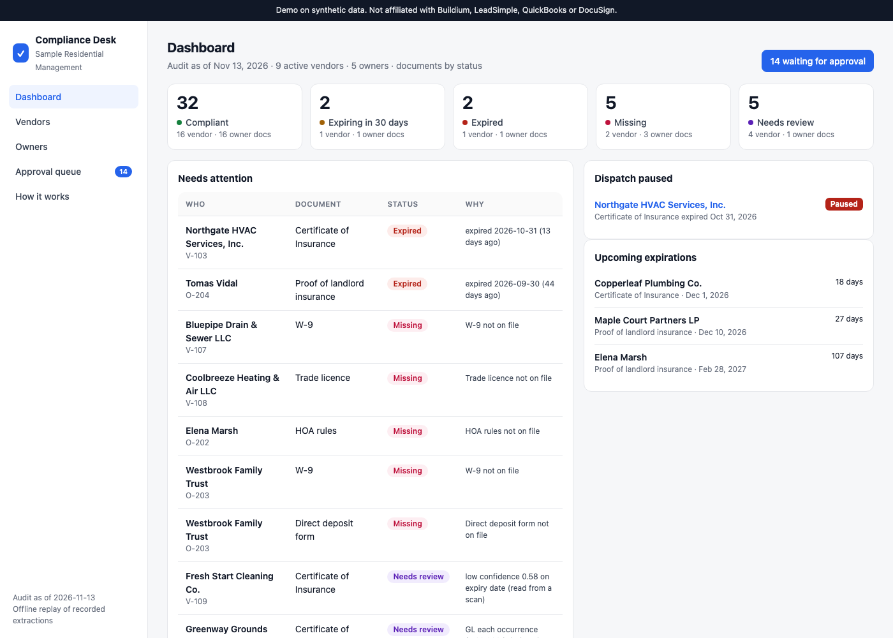
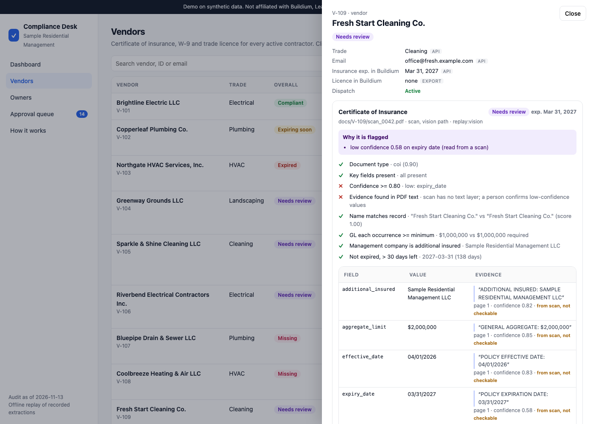
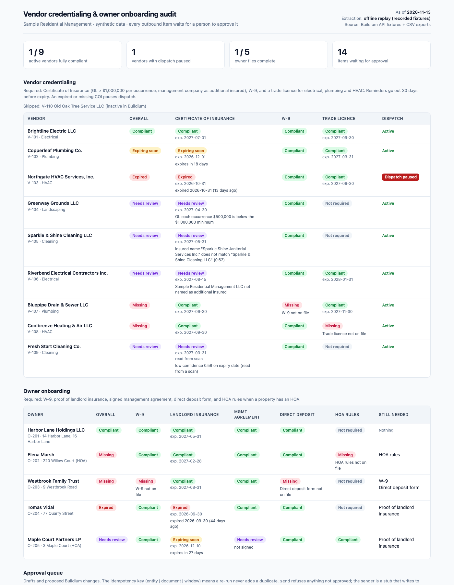

**Vendor credentialing and owner onboarding audit for residential property managers: it reads COIs, W-9s and licences, flags what is missing, expired or about to expire, and queues reminders that a person approves before anything is sent.**

**Live demo:** https://sibrahimpa1.github.io/pm-compliance-agent/ (synthetic data, runs in the browser, nothing is sent)

# pm-compliance-agent

It checks every active vendor for a valid Certificate of Insurance, a W-9 and a
trade licence, and every new owner for the documents onboarding needs, using
fields extracted from the uploaded PDFs with the page and line each value came
from. Vendors with an expired or missing COI are paused for dispatch, renewal
reminders and owner follow-ups are drafted 30 days ahead, and every outbound
item waits in an approval queue.



| Vendor detail with evidence | Offline HTML report |
| --- | --- |
|  |  |

## The problem

A property manager dispatches dozens of contractors a week. Each one should have
general liability of at least $1M per occurrence, name the management company as
additional insured, have a W-9 on file, and hold a current licence if the trade
needs one. Certificates expire on different days, brokers send PDFs in different
layouts, and the vendor directory in Buildium rarely says which document is the
current one. Owner onboarding has the same shape: W-9, proof of landlord
insurance, a signed management agreement, a direct deposit form, and HOA rules
when the property has an HOA. Someone has to chase each missing piece until it
arrives, and nobody wants a contractor on a job the day after their insurance
lapsed.

## How it works

```
 Buildium API ──┐                         ┌─ text layer ─ pypdf ──┐
 (fixtures)     ├─ directory ─ documents ─┤                       ├─ structured fields
 CSV exports ───┘  vendors,    per entity └─ scan ─ vision path ──┘  + evidence (page, line)
                   owners,                                              │
                   properties                                          ▼
                                                     checks in code: dates, minimums,
                                                     name match, signatures, requirement
                                                     matrix (config/requirements.json)
                                                                        │
                    ┌───────────────────────────────────────────────────┤
                    ▼                                                   ▼
        dispatch pause (fail closed)                 approval queue (SQLite, idempotency keys)
        + proposed Buildium change                   reminders · requests · owner follow-ups
                                                     review tasks · Buildium changes
                                                                        │ person approves
                                                                        ▼
                                                     send (stub outbox) · apply + read back
```

- **Extraction.** pypdf reads the text layer. A structured step returns the
  document type and the fields (insured name, policy type, each-occurrence limit,
  effective and expiry dates, additional insured, TIN present and signed, licence
  number, trade, state, expiry), each with its page and source line. Live mode
  asks Claude for JSON against a schema; offline mode replays recorded JSON keyed
  by the PDF's SHA-256, so the demo and CI are deterministic. A PDF with no text
  layer goes to the vision path, replayed offline the same way.
- **Checks in code, not in the model.** The model returns values as printed.
  Code parses dates and amounts, compares expiry with an as-of date (default
  today), checks the $1M minimum and the additional insured, fuzzy-matches the
  name on the document to the vendor's legal name, and applies the requirement
  matrix per entity type and trade. Text-layer quotes are checked against the
  PDF text, so an invented quote is caught.
- **Statuses.** `compliant`, `expiring_soon` (30 days or less), `expired`,
  `missing`, `needs_review` (low confidence, a mismatch, coverage below minimum,
  unsigned, or unreadable).
- **Actions.** An expired or missing COI sets `dispatch_paused`. Reminders are
  drafted at 30 days, owner follow-ups list exactly what is missing, and
  anything uncertain becomes a review task. Each item has an idempotency key
  (entity, document type, window), so re-running the audit never creates a
  duplicate. `send` refuses anything not approved. The sender is a stub that
  writes to `out/outbox.jsonl`.

The synthetic data covers: a fully valid vendor, a COI expiring in 18 days, an
expired COI, GL below $1M, an insured name that does not match, the management
company missing as additional insured, a missing W-9, a licensed trade with no
licence, a scanned COI with a smudged expiry date, and owners with a missing HOA
rules document, missing W-9 and direct deposit form, expired landlord insurance,
and an unsigned management agreement.

## Working around Buildium API gaps

One adapter, three tiers (`pmcompliance/buildium.py`):

1. **API first.** Vendors, owners and properties come from the API. Writes go
   through the API where it allows them (here: the vendor insurance date).
2. **Exports and email second.** Fields the API does not return come from
   scheduled CSV exports: licence number and expiry, the HOA flag on a property.
   The export is also the fallback when the API is down (`--api-down` shows it).
   `API_GAPS` in the code lists each field assumed missing and where it comes
   from instead; these are assumptions to confirm against the account in week 1.
   Parsing renewed certificates that arrive by email belongs in this tier too
   (pilot item, not in this repo).
3. **Browser steps only as approved.** For a change with no API field and no
   bulk update, such as a do-not-dispatch hold, the audit queues the exact UI
   change for a person to approve. It never drives a browser on its own. After
   the change is applied, the value is read back through tier 1 or 2 and only
   then counts as done. See [docs/browser-steps.md](docs/browser-steps.md) for a
   Playwright step.

## Human in the loop and PII

- Every email, follow-up and Buildium change is a draft until a named person
  approves it. Approvals, refusals, sends and status changes go to an audit log.
- W-9s, management agreements and direct deposit forms are never auto-accepted
  when something is unclear; they become review tasks.
- Dispatch pauses automatically inside this system because it fails safe.
  Mirroring the pause into Buildium is an approved change.
- Tax IDs and bank account numbers are masked to the last 4 digits before text
  is sent to the model and everywhere after: the database, logs, report, outbox,
  fixtures and the web app data. A test checks every output for the full numbers.
- Known limit: the vision path sends the page image as it is. In production,
  scans would be OCR'd and masked locally first, or sent only under a
  zero-retention agreement.

## Run it

Python 3.9 or newer. Offline mode needs only pypdf.

```bash
pip install -e ".[test]"
python -m pmcompliance.demo          # out/report.html, out/state.db, site/index.html
pytest -q
```

The demo pins the as-of date to 2026-11-13 so the output matches the
screenshots; pass `--as-of YYYY-MM-DD` to change it, `--api-down` to see the
export fallback. Open `site/index.html` directly in a browser; it has no
external assets and approvals there stay in the browser.

Step by step:

```bash
python -m pmcompliance audit --as-of 2026-11-13
python -m pmcompliance queue --status pending
python -m pmcompliance approve 2 --by "Jamie Reviewer"
python -m pmcompliance send 2          # anything not approved is refused
```

Live extraction (Claude, JSON output):

```bash
pip install anthropic                  # current SDK releases need Python 3.10+
cp .env.example .env                   # set ANTHROPIC_API_KEY, then export it
python -m pmcompliance audit --live --record   # --record saves results as new fixtures
```

The fixtures in `data/fixtures/` were generated from the same spec as the
synthetic PDFs (`scripts/make_synthetic_docs.py`), so offline output is ground
truth; `--live --record` replaces them with real model output.

## Layout

```
pmcompliance/   pdfwriter (tiny PDF writer), synthetic, extract, checks, names, parsing,
                pii, buildium, actions, store (SQLite queue + audit), report, site, cli, demo
config/         requirements.json (requirement matrix, minimums, windows)
data/           docs/ (synthetic PDFs), fixtures/ (recorded extractions), buildium/ (API + exports)
site/           the static web app served by GitHub Pages
docs/           screenshots, browser-steps.md
```

CI runs the tests and the offline demo on Python 3.9 and 3.12. A second workflow
builds `site/` from the pipeline and publishes it to GitHub Pages.

## From this MVP to a 2-week pilot

- **Days 1-3:** connect to the real Buildium account read-only; confirm which
  fields the API returns and turn `API_GAPS` into facts; schedule the exports.
- **Days 3-6:** run live extraction on a sample of real COIs, W-9s and licences;
  record them as fixtures; measure accuracy per field and set the confidence
  threshold from that, not from a guess.
- **Days 6-9:** agree the requirement matrix with the operations lead (minimums,
  trades, state licence rules, owner checklist); wire the approval queue into the
  tool the team already uses (email drafts, LeadSimple tasks or Slack).
- **Days 9-12:** turn on sending for approved reminders and follow-ups; add
  email intake for renewed certificates; record the first browser steps.
- **Days 13-14:** review with the team: what they approved, edited or rejected,
  and which checks to tighten.

## Notes

Synthetic data only: every vendor, owner, address, policy number and tax ID is
invented. Not affiliated with Buildium, LeadSimple, QuickBooks or DocuSign; they
are named only as integration targets.

MIT License. Copyright (c) 2026 Senka Ibrahimpašić.
